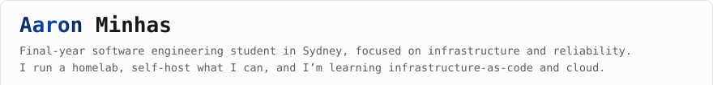
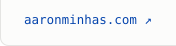
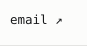
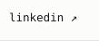
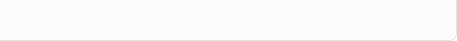

<picture><source media="(prefers-color-scheme: dark)" srcset="assets/hero-dark.svg"></picture> <a href="https://aaronminhas.com"><picture><source media="(prefers-color-scheme: dark)" srcset="assets/strip-site-dark.svg"></picture></a><a href="mailto:contact@aaronminhas.com"><picture><source media="(prefers-color-scheme: dark)" srcset="assets/strip-email-dark.svg"></picture></a><a href="https://linkedin.com/in/aaronminhas"><picture><source media="(prefers-color-scheme: dark)" srcset="assets/strip-linkedin-dark.svg"></picture></a><picture><source media="(prefers-color-scheme: dark)" srcset="assets/strip-end-dark.svg"></picture>

